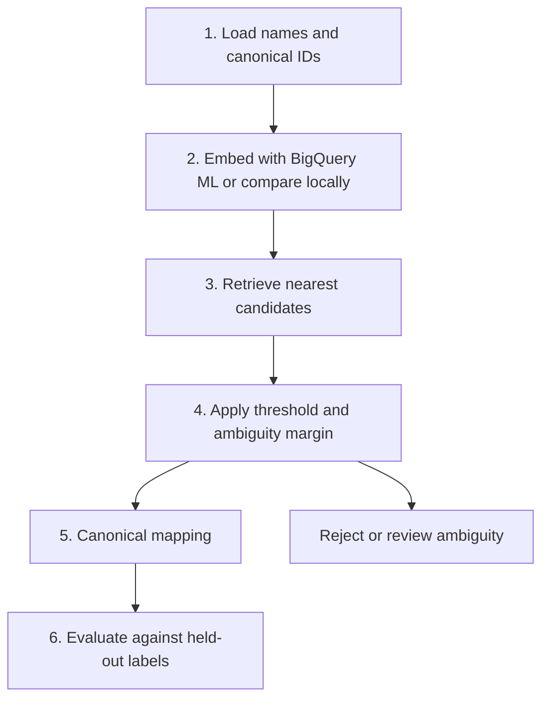
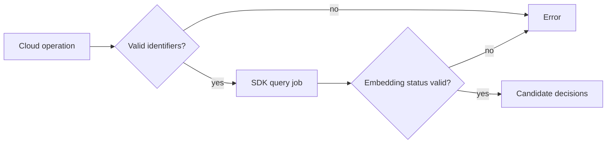

# BigQuery vendor entity matching

This coursework adaptation maps vendor names to canonical catalog IDs, rejects weak candidates, and flags close candidates as ambiguous. It implements a local lexical comparator and an explicit BigQuery SDK path. The local comparator is **not Gemini**; cloud SQL has not been executed against BigQuery.

## Flow



1. <a id="step-load"></a>[Load](src/entity_matching/evaluation.py) generated names, IDs and nonmatches; the cloud input schema is `id STRING, content STRING` with unique non-null IDs. See [holdout design](#technique-holdout).
2. <a id="step-embed"></a>[Embed](src/entity_matching/sql/embed.sql) via `ML.GENERATE_EMBEDDING`, or use [local lexical similarity](src/entity_matching/core.py). [Register](src/entity_matching/sql/register.sql) a remote Gemini model once. See [lexical comparison](#technique-lexical).
3. <a id="step-search"></a>[Search](src/entity_matching/sql/search.sql) the two nearest catalog vectors using brute-force cosine `VECTOR_SEARCH`; failed embeddings and duplicate IDs stop the query. Local matching compares every pair. See [vector search](#technique-vector).
4. <a id="step-decide"></a>[Decide](src/entity_matching/core.py) using threshold and runner-up margin. Ties or close results are ambiguous; no candidates or weak scores are rejected. See [thresholds](#technique-threshold).
5. <a id="step-map"></a>A matched decision contains the canonical catalog ID; ambiguous and rejected decisions contain no ID. This is a mapping, not transitive clustering.
6. <a id="step-evaluate"></a>[Calibrate and evaluate](src/entity_matching/evaluation.py) using 200 calibration entities and 1,000 disjoint holdout entities. See [holdout design](#technique-holdout).



## Run

```powershell
python -m venv .venv
.venv/Scripts/python -m pip install -r requirements-lock.txt
.venv/Scripts/python -m pip install --no-deps -e .
.venv/Scripts/python -m entity_matching evaluate --output evidence/disjoint-evaluation.json
.venv/Scripts/python -m pytest -q
.venv/Scripts/ruff check .
.venv/Scripts/python -m build --no-isolation
```

Cloud operations are opt-in and can incur charges. Provision a same-location BigQuery dataset and cloud resource connection with permissions separately. `python -m entity_matching cloud --help` documents required IDs; call `register`, then `embed` once for catalog and once for queries using fresh destination tables, then `search`. Input tables must have `id` and `content`; embedding output contains `id`, `content`, `embedding`, and `status`. `CREATE TABLE` fails instead of replacing data. The search score is `1 - cosine_distance / 2`; local lexical scores have a different scale, so calibrate each threshold separately. Check failed status rows and quotas before retrying. Query identifiers are validated and values parameterized; the fixed model endpoint is not user-interpolated. Both [group-by SQL](src/entity_matching/sql/exact_baseline.sql) and local exact matching lowercase and trim the name, preserving punctuation and internal spaces. The SQL baseline groups catalog keys; local exact matching joins query keys to those catalog keys and rejects collisions.

## Techniques

<a id="technique-threshold"></a><details><summary>Threshold and margin</summary>

[Decision logic](src/entity_matching/core.py) rejects low scores and close runner-ups. This reduces forced matches but may leave valid matches for review. A supervised calibrated classifier is an alternative when labeled data exists.
</details>

<a id="technique-lexical"></a><details><summary>Exact group and lexical comparison</summary>

[Exact groups](src/entity_matching/sql/exact_baseline.sql) expose duplicate keys; [SequenceMatcher](src/entity_matching/core.py) computes a character sequence similarity ratio with `autojunk=False` after lowercase and trim. Both are transparent but lack semantic understanding. The generated benchmark uses ASCII; Python and BigQuery Unicode case and whitespace behavior should be verified on the target data. A learned embedding is the alternative.
</details>

<a id="technique-vector"></a><details><summary>Vector search</summary>

[BigQuery SQL](src/entity_matching/sql/search.sql) requests two brute-force cosine neighbors so margin decisions can detect ambiguity. An approximate index can improve scale but may miss a true neighbor; no cloud latency or recall is measured here.
</details>

<a id="technique-holdout"></a><details><summary>Held-out synthetic evaluation</summary>

[Generator and runner](src/entity_matching/evaluation.py) use independent seeds for names, entity split and query variants. The holdout catalog contains 1,000 entities; 100 have positive queries, while 900 are distractors. Fifty unknown queries include 30 near-name branch homonyms. The 200 calibration IDs never enter the holdout catalog or queries. Unrelated negatives use codes derived from each split's distinct entity identities; assertions check unique query IDs within each split and disjoint IDs and normalized query texts across splits. Calibration uses its own query seed and evaluates a fixed grid, maximizing precision, then true positives, with higher threshold and margin as deterministic tie-breaks. It freezes the selected values before the holdout is scored. This tests a controlled workflow, not real vendor distributions. A separately labeled real corpus is the alternative for deployment calibration.
</details>

## Measurement and limitations

The [large raw receipt](evidence/large-evaluation.json) contains five interleaved timings per method, every prediction, error count, ambiguity count and work count. Each run evaluates 150 queries against 1,000 catalog entries (150,000 comparisons), including 50 unknowns. The earlier [small receipt](evidence/verification.json) is preserved but used a different normalization and is not comparable. These synthetic results do not establish real-world performance, semantic quality, or cloud performance. Threshold 0.8 and margin 0.05 are illustrative fixed choices, not calibrated values; there is no training. A wrong accepted ID counts as both a false positive and false negative; rejected positives count as false negatives. Reproducibility details and source hashes are in [environment receipt](evidence/environment.txt).

| Method | TP / FP / FN | Precision / recall / F1 | Unknown accepted | Ambiguous | Time range per run |
| --- | --- | --- | --- | --- | --- |
| Exact | 34 / 0 / 66 | 1.000 / 0.340 / 0.507 | 0 / 50 | 0 | 56.12–61.87 ms |
| Lexical | 87 / 18 / 13 | 0.829 / 0.870 / 0.849 | 18 / 50 | 25 | 2,013.19–2,372.07 ms |

The near-name false positives show why this threshold is unsuitable for unreviewed mapping. Timings are workload observations, not a general speed claim; no profiling or cloud timing was performed.

The [current calibrated receipt](evidence/disjoint-evaluation.json) compares three policies on the identical holdout and records the calibration grid, split IDs, normalized query texts, every prediction, and five rotated runs per policy. Calibration selected threshold **0.90** and margin **0.025** from the disjoint calibration set, achieving calibration precision 1.0 with 100 true positives. On this synthetic holdout the fixed lexical policy accepted 105 of 150 queries, including 18 unknowns, and flagged 25 ambiguous; the calibrated policy accepted 100, rejected 50, flagged none ambiguous, and made no observed errors. Exact matching accepted 34 and rejected 116. Calibrated holdout precision/recall/F1 were 1.0/1.0/1.0. These outcomes are specific to the generated naming patterns and are not evidence of real-world reliability; threshold selection can overfit even a disjoint synthetic calibration set. Earlier calibrated receipts are retained for history but contained 20 repeated unrelated-negative texts across splits and are superseded by this campaign.

## Dependencies

The pinned runtime SDK is [Google Cloud BigQuery](https://github.com/googleapis/google-cloud-python/tree/main/packages/google-cloud-bigquery) (Apache-2.0). Development tools are [pytest](https://github.com/pytest-dev/pytest), [Ruff](https://github.com/astral-sh/ruff), [build](https://github.com/pypa/build), and [setuptools](https://github.com/pypa/setuptools), each MIT according to installed package metadata. `pip check` verifies installed dependency compatibility; official source identities were checked. The lock pins transitive versions but has no artifact hashes, and no vulnerability audit was performed, so it does not establish supply-chain security.

## Terminology and interview walkthrough

An **embedding** is a numeric vector; **cosine distance** compares direction; a **canonical ID** identifies the catalog target. **Precision** measures correct accepted mappings, **recall** measures recovered positives, and **F1** combines them. A **nonmatch** has no catalog target; an **ambiguity** is a close top-two result. For a positive query, follow [load](#step-load), [compare](#step-embed), [rank](#step-search), and [decide](#step-decide): the best result must clear 0.8 and exceed the runner-up by more than 0.05. The evaluator compares the returned ID with its known label. A near-name branch is deliberately labeled unknown, so an accepted catalog ID is a false positive.

## Provenance

[UT Austin CS 329E final project option 1](https://www.cs.utexas.edu/~scohen/cs329e_spr25/projects/final-project.pdf) proposes embedding-based fuzzy matching, nearest-neighbor distance thresholds and downstream standardization. This project implements the mapping, local comparison and evaluation; it adapts the brief to a CLI and SDK rather than Colab. Cloud model registration, embedding generation and vector search are implemented but not run. It is not a claim of course completion. Primary references: [ML.GENERATE_EMBEDDING](https://docs.cloud.google.com/bigquery/docs/reference/standard-sql/bigqueryml-syntax-generate-embedding), [VECTOR_SEARCH](https://docs.cloud.google.com/bigquery/docs/reference/standard-sql/search_functions), and [CREATE MODEL](https://docs.cloud.google.com/bigquery/docs/reference/standard-sql/bigqueryml-syntax-create-remote-model-embedding-maas).

Potential resume bullets, scoped to demonstrated work:

- Built a Python and SQL entity-matching prototype with explicit canonical mapping, rejection and ambiguity handling, plus a BigQuery SDK integration for embedding and vector-search jobs.
- Designed a reproducible entity-disjoint synthetic evaluation comparing exact and lexical matching across five local repeats, recording precision, recall, F1 and comparison counts.
